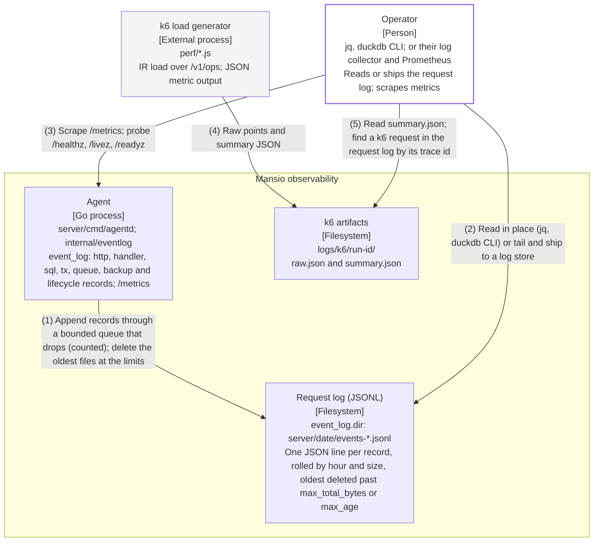

# Container — observability path

Redrawn on 2026-11-12 for ADR 0014: the offline event-log tool and its DuckDB file are deleted; agentd's
request log is read in place or shipped. Both formats are generated from
`diagrams/c4-container-observability.py`; numbered relationships are identical. All boxes describe landed
code.

## Relationships

| # | From              | To                  | Relationship                                                                                       |
| - | ----------------- | ------------------- | -------------------------------------------------------------------------------------------------- |
| 1 | Agent             | Request log (JSONL) | Append records through a bounded queue that drops (counted); delete the oldest files at the limits |
| 2 | Operator          | Request log (JSONL) | Read in place (jq, duckdb CLI) or tail and ship to a log store                                     |
| 3 | Operator          | Agent               | Scrape /metrics; probe /healthz, /livez, /readyz                                                   |
| 4 | k6 load generator | k6 artifacts        | Raw points and summary JSON                                                                        |
| 5 | Operator          | k6 artifacts        | Read summary.json; find a k6 request in the request log by its trace id                            |

## Runtime notes

agentd writes the request log when its config has event_log (dir, level, trace_sql, buffer and the size and
age limits); server/internal/eventlog owns the record format (goldens in its testdata). Emitting never blocks
a request: a full queue drops the record, and drops, write losses and deletions are counted on /metrics
(mansio_eventlog_*). mansio ships no log collector, log store, Prometheus server or dashboard: those are the
deployment's. The offline TypeScript tool that loaded the files into DuckDB is deleted (ADR 0014);
docs/observability.md has the fields and worked jq and duckdb queries.
