# Container — observability path

Redrawn for IR-6 (ADR 0013) on 2026-11-06 on `ir/06-cutover` from main `7cf4ba6`: the Deno platform is gone
and the server is the Go server in `server/`. Both formats are generated from
`diagrams/c4-container-observability.py`; numbered relationships are identical. All boxes describe landed
code.

```mermaid
flowchart TB
    subgraph platform["Mansio observability"]
        agentd["Agent<br/>[Go process]<br/>server/cmd/agentd; internal/eventlog<br/>event_log: http, handler, sql, tx, backup and lifecycle records"]
        jsonl["Structured event sources<br/>[Filesystem]<br/>event_log.dir: role/date/events-*.jsonl<br/>agentd JSONL (role server); the CLI&#x27;s own (role reader); quarantine beside source"]
        duck["Derived event log<br/>[DuckDB file]<br/>EVENTLOG_DUCKDB<br/>Schema v2; typed events (sql_events.path), watermarks, k6_points"]
        cli["Logs CLI<br/>[Deno process]<br/>scripts/logs.ts; eventlog/<br/>Ingest/list/query/sweep; named catalog"]
        loader["k6 point loader<br/>[Deno process]<br/>perf/ingest_k6.ts<br/>Loads raw points into k6_points"]
        results["k6 artifacts<br/>[Filesystem]<br/>logs/k6/run-id/<br/>raw.json and summary.json"]
    end
        k6["k6 load generator<br/>[External process]<br/>perf/*.js<br/>IR load over /v1/ops; JSON metric output"]
    agentd -->|"(1) Append JSONL in core/events.ts format through a dropping queue"| jsonl
    cli -->|"(2) Offline ingest-then-sweep; seal tails, gzip/delete safe files; dry-run plans only"| jsonl
    cli -->|"(3) Transactional ingest (adds sql_events.path if missing); read-only catalog SELECT"| duck
    k6 -->|"(4) Raw points and summary JSON"| results
    results -->|"(5) Read raw.json for selected run id"| loader
    loader -->|"(6) Insert k6_points; catalog compares overlapping HTTP buckets"| duck
    classDef planned stroke-dasharray: 5 3
    classDef person fill:#fff,stroke-width:2px
    classDef external fill:#f4f4f4
    class k6 external
```

## Relationships

| # | From              | To                       | Relationship                                                                      |
| - | ----------------- | ------------------------ | --------------------------------------------------------------------------------- |
| 1 | Agent             | Structured event sources | Append JSONL in core/events.ts format through a dropping queue                    |
| 2 | Logs CLI          | Structured event sources | Offline ingest-then-sweep; seal tails, gzip/delete safe files; dry-run plans only |
| 3 | Logs CLI          | Derived event log        | Transactional ingest (adds sql_events.path if missing); read-only catalog SELECT  |
| 4 | k6 load generator | k6 artifacts             | Raw points and summary JSON                                                       |
| 5 | k6 artifacts      | k6 point loader          | Read raw.json for selected run id                                                 |
| 6 | k6 point loader   | Derived event log        | Insert k6_points; catalog compares overlapping HTTP buckets                       |

## Runtime notes

agentd writes the event log when its config has event_log (dir, level, trace_sql); the records are
byte-identical to core/events.ts toJsonLine (goldens shared with Go, IR-4c). Nothing in the server opens
DuckDB: ingest and analysis are offline, in the logs CLI (eventlog/), and the DuckDB file has a single writer,
so a query fails while an ingest holds it. The CLI writes its own records under the reader role. Retention
bounds JSONL only, requires committed watermarks and matching hashes, and never touches today or the CLI's
open file. Derived tables are never pruned. Gzipped retained sources are not re-ingested. Until IR-6 the Deno
server and its reader child process did all of this in-process (ADR 0004).
