# Container — request path

Redrawn for IR-6 (ADR 0013) on 2026-11-06 on `ir/06-cutover` from main `7cf4ba6`: the Deno platform is gone
and the server is the Go server in `server/`. Both formats are generated from
`diagrams/c4-container-platform.py`; numbered relationships are identical. All boxes describe landed code.

```mermaid
flowchart TB
    subgraph platform["Mansio cluster"]
        edge["Edge<br/>[Go process]<br/>server/cmd/edge<br/>Forwards /v1/ops to the ticket&#x27;s VM; registry from controld"]
        agentd["Agent<br/>[Go process]<br/>server/cmd/agentd<br/>IR front (/v1/ops); one actor per database; static, tenancy or durable mode"]
        files["Databases<br/>[SQLite 3 files]<br/>agentd db_dir<br/>One file per (tenant, app): tenant:app.db"]
        controld["Control plane<br/>[Go process]<br/>server/cmd/controld<br/>Resolve and tickets; create, move, attest-dead, restore; tenancy admin and auth"]
        pg["Control store<br/>[Postgres 17]<br/>schema control<br/>Placement, issuer keys, tenants, API keys, users, sessions"]
        tools["Operator CLIs<br/>[Go processes]<br/>server/cmd/dbtool; server/cmd/mansioctl<br/>Restore, import, verify; tenant and key admin"]
    end
        client["Client SDK<br/>[Library in caller process]<br/>sdk/client.ts; sdk/transport.ts<br/>Runs handlers; sends IR; resolves and caches tickets"]
        objects["Object storage<br/>[External system]<br/>S3 (SeaweedFS in dev)<br/>SQLite generations and manifests"]
    client -->|"(1) HTTP POST /v1/resolve; API key or session; ticket and endpoint back"| controld
    client -->|"(2) HTTP POST /v1/ops (IR); ticket; X-Trace-Id"| edge
    edge -->|"(3) HTTP /v1/ops, routed by the ticket's VM"| agentd
    edge -->|"(4) HTTP VM registry and ticket keys"| controld
    agentd -->|"(5) modernc SQLite; group-committed writes and reads"| files
    agentd -->|"(6) S3 HTTP; write-back of generations, restore on claim"| objects
    agentd -->|"(7) HTTP ticket keys and registered schemas (keys_url, schemas_url)"| controld
    controld -->|"(8) HTTP lifecycle: claim, release, move"| agentd
    agentd -->|"(9) Postgres protocol; placement rows (placement_pg)"| pg
    controld -->|"(10) Postgres protocol; placement, tenancy, issuer"| pg
    tools -->|"(11) S3 HTTP; dbtool restore, import, verify"| objects
    tools -->|"(12) Admin HTTP; /admin/tenants, /admin/backup"| agentd
    classDef planned stroke-dasharray: 5 3
    classDef person fill:#fff,stroke-width:2px
    classDef external fill:#f4f4f4
    class client external
    class objects external
```

## Relationships

| #  | From          | To             | Relationship                                                        |
| -- | ------------- | -------------- | ------------------------------------------------------------------- |
| 1  | Client SDK    | Control plane  | HTTP POST /v1/resolve; API key or session; ticket and endpoint back |
| 2  | Client SDK    | Edge           | HTTP POST /v1/ops (IR); ticket; X-Trace-Id                          |
| 3  | Edge          | Agent          | HTTP /v1/ops, routed by the ticket's VM                             |
| 4  | Edge          | Control plane  | HTTP VM registry and ticket keys                                    |
| 5  | Agent         | Databases      | modernc SQLite; group-committed writes and reads                    |
| 6  | Agent         | Object storage | S3 HTTP; write-back of generations, restore on claim                |
| 7  | Agent         | Control plane  | HTTP ticket keys and registered schemas (keys_url, schemas_url)     |
| 8  | Control plane | Agent          | HTTP lifecycle: claim, release, move                                |
| 9  | Agent         | Control store  | Postgres protocol; placement rows (placement_pg)                    |
| 10 | Control plane | Control store  | Postgres protocol; placement, tenancy, issuer                       |
| 11 | Operator CLIs | Object storage | S3 HTTP; dbtool restore, import, verify                             |
| 12 | Operator CLIs | Agent          | Admin HTTP; /admin/tenants, /admin/backup                           |

## Runtime notes

This is the multi-node shape (IR-5a, e2e scale_out). A single agentd also runs alone: static mode (a keys
file, minted tickets, files it finds in db_dir), with a tenancy section (app tokens, API keys or sessions on
/v1/ops, its own control schema in Postgres) or durable (S3 generations, placement_dir or placement_pg); then
the SDK sends /v1/ops straight to it and there is no edge or controld. Writes are acknowledged before
write-back, so a kill -9 can lose the window (intermediate-representation-protocol.md §9). mansioctl talks to
whichever process mounts /admin/tenants (agentd or controld).
