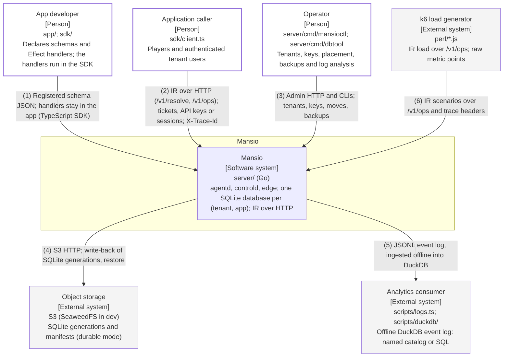

# System Context

Redrawn for IR-6 (ADR 0013) on 2026-11-06 on `ir/06-cutover` from main `7cf4ba6`: the Deno platform is gone
and the server is the Go server in `server/`. Both formats are generated from
`diagrams/c4-context-document-db.py`; numbered relationships are identical. All boxes describe landed code.

## Relationships

| # | From               | To                 | Relationship                                                                   |
| - | ------------------ | ------------------ | ------------------------------------------------------------------------------ |
| 1 | App developer      | Mansio             | Registered schema JSON; handlers stay in the app (TypeScript SDK)              |
| 2 | Application caller | Mansio             | IR over HTTP (/v1/resolve, /v1/ops); tickets, API keys or sessions; X-Trace-Id |
| 3 | Operator           | Mansio             | Admin HTTP and CLIs; tenants, keys, moves, backups                             |
| 4 | Mansio             | Object storage     | S3 HTTP; write-back of SQLite generations, restore                             |
| 5 | Mansio             | Analytics consumer | JSONL event log, ingested offline into DuckDB                                  |
| 6 | k6 load generator  | Mansio             | IR scenarios over /v1/ops and trace headers                                    |

## Runtime notes

Since IR-6 the server is the Go server in server/; the Deno platform was deleted (ADR 0013). App handlers run
in the client SDK and reach the server as IR requests (intermediate-representation/spec/v1.md); no application
SQL crosses the client boundary. Tenant identity comes from tickets, API keys or sessions (ADR 0012); Postgres
is inside the system, shown at Level 2. No external identity provider is wired.
